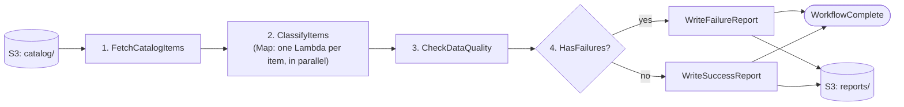

# Catalog Data Quality Checker

A serverless pipeline built on **AWS Step Functions** that automatically audits an e-commerce product catalog. It reads product files from Amazon S3, classifies each product into a category, checks the data quality, and writes a JSON report back to S3.

The whole workflow can also run on your laptop with no AWS account, using mocked AWS services.

---

## Table of Contents

- [What Problem Does This Solve?](#what-problem-does-this-solve)
- [Key Concepts for Beginners](#key-concepts-for-beginners)
- [How It Works](#how-it-works)
- [Technologies Used](#technologies-used)
- [Project Structure](#project-structure)
- [Getting Started (Local)](#getting-started-local)
- [Data Formats](#data-formats)
- [Quality Rules](#quality-rules)
- [How Classification Works](#how-classification-works)
- [Testing](#testing)
- [Deploying to AWS](#deploying-to-aws)
- [Fault Tolerance and Scalability](#fault-tolerance-and-scalability)
- [Design Decisions](#design-decisions)
- [Future Improvements](#future-improvements)
- [Further Reading](#further-reading)

---

## What Problem Does This Solve?

An online store keeps each product as a small JSON file in S3. Checking thousands of these files by hand for missing labels or wrong categories is slow and error-prone.

This project automates the check. For every product it answers:

1. Which category does it belong to, and how confident is the classifier?
2. Does it have enough complete labels (brand, color, and so on)?
3. Does it pass or fail the quality rules, and why?

The output is one report with the overall pass rate and the issues found for each item.

---

## Key Concepts for Beginners

| Term | Plain-English meaning |
|------|-----------------------|
| **AWS Lambda** | A small function that runs in the cloud only when called. No servers to manage. |
| **AWS Step Functions** | A service that chains steps (here, Lambdas) into a workflow and handles ordering, retries, and branching. |
| **State machine** | The workflow itself, described as a set of named steps ("states") and the transitions between them. |
| **Map state** | A step that runs the same task once for every item in a list, in parallel. |
| **Amazon S3** | Cloud file storage. Files live in "buckets" under "keys" (paths). |
| **CloudFormation** | A way to describe AWS resources in a YAML file so they can be created repeatably. |
| **moto** | A Python library that fakes AWS services, so you can test without a real AWS account. |

---

## How It Works



| Step | Lambda | What it does |
|------|--------|--------------|
| 1. FetchCatalogItems | [lambdas/fetch_catalog](lambdas/fetch_catalog/handler.py) | Lists and reads every `.json` file under an S3 prefix. Uses pagination, so it handles more than 1,000 files. |
| 2. ClassifyItems | [lambdas/classify_image](lambdas/classify_image/handler.py) | Runs once per item, in parallel. Assigns a category and confidence score from the item's `image` text. |
| 3. CheckDataQuality | [lambdas/check_quality](lambdas/check_quality/handler.py) | Checks label completeness and classification confidence. Marks each item `PASS` or `FAIL`. |
| 4. HasFailures | Choice state | Routes to the failure or success report writer, depending on whether any item failed. |
| 5. WriteResults | [lambdas/write_results](lambdas/write_results/handler.py) | Saves the report to S3 as `reports/quality_report_<timestamp>_<id>.json`. |

The workflow is defined in [statemachine/definition.json](statemachine/definition.json), which is the single source of truth for the flow.

---

## Technologies Used

| Area | Technology | Why it is used |
|------|-----------|----------------|
| Language | Python 3.11 (Lambda runtime) | All Lambda code and local tooling. |
| Orchestration | AWS Step Functions | Coordinates steps, retries, and branching. |
| Compute | AWS Lambda | Runs each step without managing servers. |
| Storage | Amazon S3 | Holds the input catalog files and output reports. |
| Infrastructure as Code | AWS CloudFormation with the SAM transform | Creates the bucket, Lambdas, IAM roles, and state machine from one template. |
| Security | AWS IAM | Least-privilege roles for the Lambdas and the state machine. |
| Logging | Amazon CloudWatch Logs | Lambda log output. |
| AWS SDK | boto3 | Lets Python read and write S3. |
| Classification | Python standard library (`re`) | Keyword matching with no machine-learning dependencies. |
| Workflow language | Amazon States Language (JSON) | Describes the state machine. |
| Testing | pytest | Test framework. |
| AWS mocking | moto | Fakes S3 so tests and local runs work offline. |

Python dependencies ([requirements.txt](requirements.txt)):

```
boto3>=1.34.0
moto[s3,stepfunctions,lambda,iam]>=5.0.0
pytest>=7.0.0
```

---

## Project Structure

```
python_stepfunction/
├── cloudformation/
│   └── template.yaml            # AWS resources: S3 bucket, 4 Lambdas, 2 IAM roles, state machine
├── lambdas/
│   ├── fetch_catalog/           # Step 1: read items from S3
│   │   └── handler.py
│   ├── classify_image/          # Step 2: classify one item
│   │   └── handler.py
│   ├── check_quality/           # Step 3: apply quality rules
│   │   └── handler.py
│   └── write_results/           # Step 4: write the report to S3
│       └── handler.py
├── sample_data/                 # 5 example catalog items (PROD-001 to PROD-005)
├── statemachine/
│   └── definition.json          # Step Functions workflow definition
├── tests/
│   └── test_workflow.py         # Unit and end-to-end tests (pytest + moto)
├── run_local.py                 # Runs the full workflow locally against mocked S3
├── requirements.txt             # Python dependencies
├── DESIGN_DOC.md                # Detailed design and architecture
└── ISSUES_AND_ENHANCEMENTS.md   # Issues found and improvements made
```

Each Lambda is one `handler.py` file with a `handler(event, context)` function, which is the entry point AWS calls. Data flows between steps as JSON: each step receives the previous step's output.

---

## Getting Started (Local)

### Prerequisites

- Python 3.11 or newer
- `pip`

No AWS account or credentials are needed for local runs.

### 1. Create a virtual environment and install dependencies

```bash
cd python_stepfunction
python3 -m venv .venv
source .venv/bin/activate        # Windows: .venv\Scripts\activate
pip install -r requirements.txt
```

### 2. Run the workflow locally

```bash
python3 run_local.py
```

This script:

1. Creates a fake S3 bucket in memory and uploads the 5 sample items.
2. Runs the four steps in order, like Step Functions would.
3. Prints each step's output and the final quality report.

### Sample items

| File | `image` text | Expected category |
|------|--------------|-------------------|
| `catalog_item_1.json` | Sony Wireless Headphones | Electronics |
| `catalog_item_2.json` | Nike Running Shoes | Footwear |
| `catalog_item_3.json` | Starbucks Coffee Beans | Food & Beverage |
| `catalog_item_4.json` | Samsung TV | Electronics |
| `catalog_item_5.json` | iPhone | Mobile Phones |

---

## Data Formats

### Input: one catalog item (`catalog/*.json` in S3)

```json
{
  "item_id": "PROD-001",
  "name": "Wireless Bluetooth Headphones",
  "image": "Sony Wireless Headphones",
  "labels": {
    "category": "Electronics",
    "brand": "SoundMax",
    "color": "Black",
    "connectivity": "Bluetooth 5.0",
    "type": "Over-ear"
  },
  "price": 79.99,
  "in_stock": true
}
```

`image` is a short text descriptor that stands in for the product image. The classifier reads this field.

### Output: quality report (`reports/*.json` in S3)

```json
{
  "generated_at": "20260419T120000Z",
  "total_items": 5,
  "passed": 2,
  "failed": 3,
  "pass_rate": "40.0%",
  "results": [
    {
      "item_id": "PROD-001",
      "name": "Wireless Bluetooth Headphones",
      "total_labels": 5,
      "non_empty_labels": 5,
      "empty_labels": [],
      "classification": { "category": "Electronics", "confidence": 0.7225, "status": "OK" },
      "quality": "PASS",
      "issues": []
    }
  ]
}
```

---

## Quality Rules

An item fails if any rule below is broken. Thresholds are constants at the top of [lambdas/check_quality/handler.py](lambdas/check_quality/handler.py).

| Issue code | Meaning |
|-----------|---------|
| `NO_LABELS` | The item has zero labels. |
| `LOW_LABEL_COUNT` | Fewer than 3 labels. |
| `EMPTY_LABELS` | One or more labels have blank values. |
| `CLASSIFICATION_FAILED` | The `image` text was missing, so classification could not run. |
| `LOW_CLASSIFICATION_CONFIDENCE` | Classifier confidence is below 0.5. |

---

## How Classification Works

The classifier uses a simple, transparent keyword approach rather than machine learning:

1. Split the `image` text into lowercase words.
2. Compare the words with the keyword list of each of six categories: Electronics, Mobile Phones, Footwear, Food & Beverage, Fitness, and Home & Kitchen. Substring matching is used as a fallback for compound words.
3. Score each matching category: `confidence = base_confidence × (0.5 + 0.5 × match_ratio)`.
4. Pick the highest-scoring category and set a status:
   - `OK`: confidence is 0.5 or higher
   - `LOW_CONFIDENCE`: confidence is below 0.5, or no keyword matched (category `Uncategorized`)
   - `FAILED`: the text is missing (category `Unknown`)

To add or tune a category, edit `CATEGORY_TAXONOMY` in [lambdas/classify_image/handler.py](lambdas/classify_image/handler.py).

---

## Testing

```bash
python3 -m pytest tests/test_workflow.py -v
```

The suite has 20 tests in 6 classes. They cover S3 fetching and pagination, label rules, classification accuracy and edge cases, classification-aware quality checks, report writing, and one full end-to-end pipeline run. All S3 calls are mocked with moto, so the tests are deterministic and run offline.

---

## Deploying to AWS

Prerequisites: the AWS CLI configured with credentials, and an S3 bucket to hold the packaged Lambda code.

```bash
# 1. Package: uploads Lambda code and the state machine definition to S3, rewrites local paths
aws cloudformation package \
  --template-file cloudformation/template.yaml \
  --s3-bucket <your-artifact-bucket> \
  --output-template-file packaged.yaml

# 2. Deploy the stack
aws cloudformation deploy \
  --template-file packaged.yaml \
  --stack-name catalog-quality-checker \
  --capabilities CAPABILITY_NAMED_IAM \
  --parameter-overrides CatalogBucketName=<your-catalog-bucket>

# 3. Upload catalog files
aws s3 cp sample_data/ s3://<your-catalog-bucket>/catalog/ --recursive

# 4. Start a run (use the StateMachineArn from the stack outputs)
aws stepfunctions start-execution \
  --state-machine-arn <StateMachineArn> \
  --input '{"bucket": "<your-catalog-bucket>", "prefix": "catalog/"}'
```

The stack creates:

- an S3 bucket (`CatalogBucketName` parameter)
- four Lambda functions: `FetchCatalogItems`, `ClassifyImageItem`, `CheckDataQuality`, `WriteQualityResults`
- an IAM role for the Lambdas (S3 access and CloudWatch Logs)
- an IAM role for Step Functions (permission to invoke the Lambdas)
- the `CatalogDataQualityChecker` state machine

Reports appear under `reports/` in the same bucket.

---

## Fault Tolerance and Scalability

| Concern | How it is handled |
|---------|-------------------|
| Transient Lambda errors | The Map state retries up to 3 times with exponential backoff (2s, 4s, 8s). |
| Unrecoverable classification error | A `Catch` records the error and continues to `CheckDataQuality`, which falls back to label-only checks. |
| One bad item | Each item is classified independently, so it does not affect the others. |
| Parallelism | `MaxConcurrency` is 10 (adjustable in the state machine definition). |
| Large catalogs | S3 pagination handles any number of files. |
| Concurrent runs | A UUID suffix in each report name prevents one run overwriting another. |

---

## Design Decisions

| Decision | Reason |
|----------|--------|
| Step Functions instead of one big Lambda | Step-level visibility, retries, and no 15-minute timeout limit. |
| Lambda instead of AWS Batch, ECS, or EMR | Classification takes milliseconds per item, so heavy compute services are overkill. |
| Keyword taxonomy instead of ML | No dependencies, deterministic, fast, and easy to extend for short text. |
| `definition.json` as the single workflow source | Avoids duplicating the workflow inside the CloudFormation template. |
| Lambda code referenced from `lambdas/` | Avoids inline code in YAML and keeps handlers readable and testable. |

---

## Future Improvements

- Send notifications through SNS when the pass rate is low.
- Trigger runs on a schedule or on S3 upload with EventBridge.
- Add a CloudWatch dashboard for pass-rate trends.
- Use Amazon Rekognition when real product images are available.
- Use Step Functions Distributed Map for catalogs beyond roughly 100,000 items.

---

## Further Reading

- [DESIGN_DOC.md](DESIGN_DOC.md): full architecture and design rationale
- [ISSUES_AND_ENHANCEMENTS.md](ISSUES_AND_ENHANCEMENTS.md): bugs fixed and enhancements made
